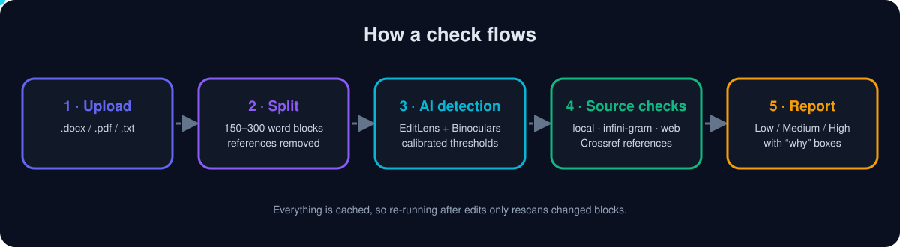

<p align="center"></p>

<p align="center">
  <br>
  <b>Explainable AI-text detection, plagiarism checks and reference verification for whole theses.</b><br>
  Free · runs on Kaggle / Colab / CPU · every rating comes with a “why” box
</p>

---

## ✨ What it does

| | Feature | Status |
|---|---|---|
| 🤖 | **AI-text detection** with EditLens (Open Pangram) + Binoculars, calibrated with a known-human sample | v2 · first real run pending |
| 🔎 | **Plagiarism**: your own sources, open web corpus (infini-gram), web + paper search | v2 · web search proven in v1 |
| 📚 | **Reference check** against Crossref (catches invented citations) | v2 · untested live |
| 🧾 | **Writing checks**: repeated sentences, leftover placeholders, missing words | tested |
| 🪟 | **Explainable UI**: Low / Medium / High cards that open to show *why* | v2 · untested live |
| ♻️ | **Cache + resume**: reruns only rescan changed blocks | proven in v1 |

<p align="center"></p>

## 🧭 How a check flows

<p align="center"></p>

## 🚀 Quick start (Kaggle or Colab, free GPU)

1. Open `notebooks/thesis_checker_v2.ipynb` in **Kaggle** (Settings → Internet **ON**, Accelerator **GPU T4**) or **Colab** (Runtime → T4 GPU).
2. **Run all cells.** The last one prints a public `gradio.live` link.
3. Upload the thesis. Settings are collapsed and already set to the recommended values.
4. *Strongly recommended:* paste 2–3 paragraphs the author definitely wrote himself into **Known-human sample**.

No notebook? `pip install -r requirements.txt && python app/app.py`.

If v2 misbehaves, `notebooks/thesis_checker_v1.ipynb` is the version proven in a real run.

## ⚙️ Recommended settings (all are the defaults)

| Setting | Default | Why |
|---|---|---|
| EditLens detector | on | Separates human / AI-edited / AI-written text |
| Binoculars detector | on, 1.5B (GPU) / 0.5B (CPU) | Second opinion; agreement raises confidence |
| High / Medium threshold | 0.60 / 0.35 | Conservative; raised automatically by a known-human sample |
| Binoculars sensitivity | 1.0 σ | Flags blocks clearly more predictable than baseline |
| Online sentence checks | 150 | Balance between coverage and throttling |
| infini-gram, web, Crossref, writing checks | on | Cheap and informative |

## 🔒 Honest limits

- No detector is proof, and **technical writing (methods, tables, definitions) is flagged wrongly more often**. Use results to decide what to rewrite, not to accuse.
- Open Pangram models are **non-commercial**, and their authors say not to use them to enforce AI policies.
- Online checks send short phrases to outside services. Turn them off for private work.
- Only a sample of sentences is checked online; “no match” is not “clean”.

Details: [`docs/LIMITATIONS_AND_ETHICS.md`](docs/LIMITATIONS_AND_ETHICS.md)

## 🗺️ Roadmap (short)

Calibration set & thresholds → sentence-level scoring → OpenAlex + paraphrase detection → definition matching → PDF/HTML report export → permanent free host. Full plan: [`docs/ROADMAP.md`](docs/ROADMAP.md).

## 📖 Docs

| Doc | Contents |
|---|---|
| [`docs/HISTORY.md`](docs/HISTORY.md) | Everything we built and figured out, in order |
| [`docs/HOW_IT_WORKS.md`](docs/HOW_IT_WORKS.md) | Scoring, thresholds, source checks |
| [`docs/RESEARCH.md`](docs/RESEARCH.md) | Detector and source research with links and caveats |
| [`docs/ROADMAP.md`](docs/ROADMAP.md) | What to build next, phase by phase |
| [`docs/HOSTING.md`](docs/HOSTING.md) | Free hosting options and trade-offs |
| [`docs/TESTING.md`](docs/TESTING.md) | How to calibrate and verify v2 |
| [`docs/index.html`](docs/index.html) | Animated landing page (GitHub Pages ready) |

## 🗂️ Layout

```
app/            app.py (v2), app_v1.py (proven v1)
notebooks/      one-file notebooks for Kaggle/Colab
assets/         animated logo, banner, pipeline, favicons, .ico, og-image
docs/           history, research, roadmap, hosting, testing, landing page
tools/          make_assets.py (regenerates every asset)
```

## 📄 License

Code: MIT (see `LICENSE`). Models and data have their own licenses; see `docs/LIMITATIONS_AND_ETHICS.md`.
